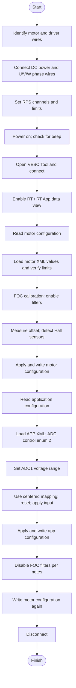
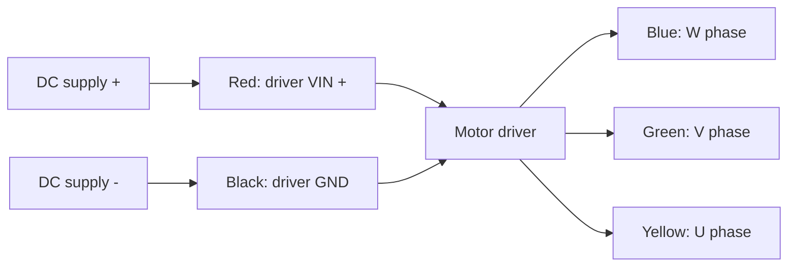
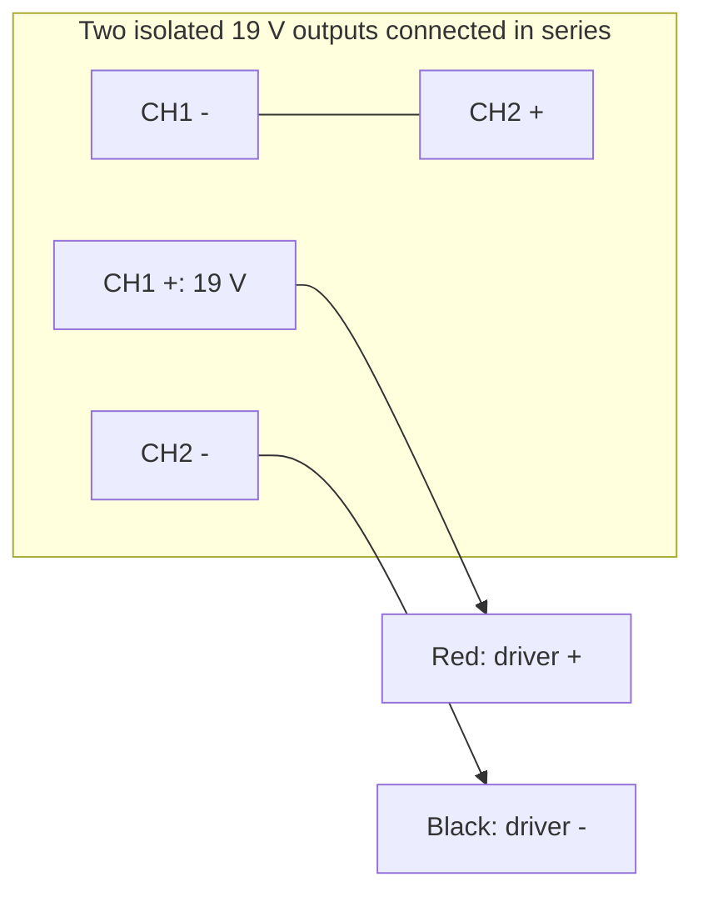
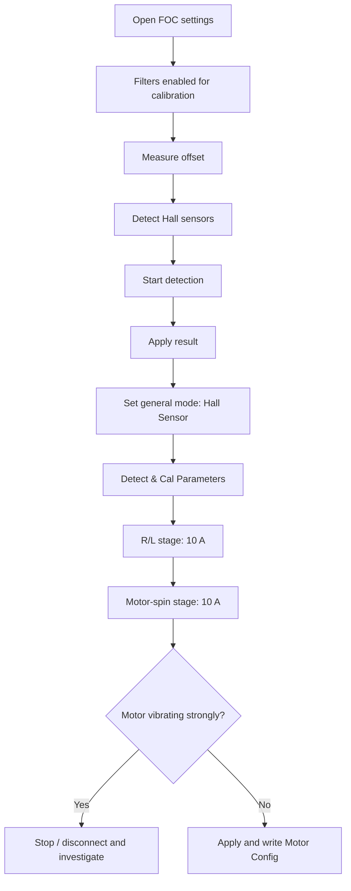
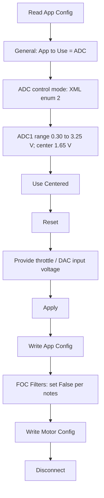

# Motor Driver Setup and VESC Tool Configuration

## 1. Overview: setup workflow

> **Sequence note:** The handwritten notes mention writing configurations at multiple stages and disabling the FOC filters after calibration. These steps are shown explicitly in the workflow.

## 2. Wiring and power supply (page 1)

### 2.1 Wire color assignments

| Wire color | Connection / function | Notes |
|---|---|---|
| Red | Positive DC (`+VE`) | Power supply input (`VIN`, RPS) to the motor driver |
| Black | Negative DC (`-VE`, GND) | Common/driver ground |
| Blue | `W` | Motor phase wire |
| Green | `V` | Motor phase wire |
| Yellow | `U` | Motor phase wire |

**Important:** The phase labels are transcribed from the notes; confirm these connections against the motor/driver labels. The red and black DC wiring must **not** be confused with the motor phase leads.

### 2.2 Regulated power supply (RPS)

- Recorded supply output: **38 V**.
- Notes state: two **19 V** supply channels connected in **series** (`19 V + 19 V`).
- Two channels are listed:

| Channel | Label | Current recorded | Voltage recorded |
|---|---|---:|---:|
| CH1 | Master | 6.2 A | 19 V |
| CH2 | Slave | 6.2 A | 19 V |

**Handwritten connection notes (page 2):**

- `CH2 (+)` to `CH1 (-)` (series link).
- `CH1 (+)` to **red** / positive supply lead.
- `CH2 (-)` to **black** / negative supply lead.
- Set voltage and current limits on the master supply/channel, as recorded.
- A **beep** is noted after powering on.

> **Electrical safety:** Series connection is only appropriate if the outputs are explicitly rated for series operation and are suitably isolated. Confirm output polarity, grounding, and the driver's actual input-voltage rating before connecting anything. The diagram represents the **written note**, not independent approval of this circuit.

## 3. Initial VESC Tool checks (pages 2–3)

1. Open **VESC Tool**.
2. Turn on the **RT** and **RT App** views to read live data (terminology follows the notes).
3. Select **Read Motor Config**.
4. Select **Read App Config**.
5. Under **Data Analysis**, observe the **real-time data**.
6. Slowly rotate the wheel by hand and observe the graph rising and falling.

> A small annotation above the wheel-rotation instruction is not legible enough to transcribe confidently.

## 4. Motor settings (pages 3–4)

### 4.1 General — loaded motor configuration

| VESC Tool setting | Loaded XML value | XML field |
|---|---:|---|
| Motor type (FOC enum 2) | `2` | `motor_type` |
| Sensor port mode (raw enum) | `0` | `m_sensor_port_mode` |
| FOC sensor mode (raw enum) | `2` | `foc_sensor_mode` |
| Motor direction inverted | `0` | `m_invert_direction` |
| Motor poles (XML value) | `25` | `si_motor_poles` |
| Gear ratio | `1` | `si_gear_ratio` |
| Wheel diameter (m) | `0.083` | `si_wheel_diameter` |

**Note:** Enum numeric codes are preserved from the XML; FOC is identified from the existing VESC setup, while exact sensor-mode names should be checked in your VESC Tool version. Do not assume an enum value is a physical wiring instruction.

### 4.2 Current — loaded motor configuration

| VESC Tool setting | Loaded XML value | XML field |
|---|---:|---|
| Motor current max (A) | `25` | `l_current_max` |
| Motor current minimum / braking (A) | `0` | `l_current_min` |
| Absolute maximum current (A) | `50` | `l_abs_current_max` |
| Battery current max (A) | `15` | `l_in_current_max` |
| Battery current minimum / regen (A) | `0` | `l_in_current_min` |
| Input current map filter | `0.02` | `l_in_current_map_filter` |

### 4.3 Voltage — loaded motor configuration

| VESC Tool setting | Loaded XML value | XML field |
|---|---:|---|
| Battery cutoff start (V) | `37` | `l_battery_cut_start` |
| Battery cutoff end (V) | `35` | `l_battery_cut_end` |
| Minimum input voltage (V) | `24` | `l_min_vin` |
| Maximum input voltage (V) | `105` | `l_max_vin` |
| Battery regen cutoff start (V) | `1000` | `l_battery_regen_cut_start` |
| Battery regen cutoff end (V) | `1100` | `l_battery_regen_cut_end` |

### 4.4 RPM — loaded motor configuration

| VESC Tool setting | Loaded XML value | XML field |
|---|---:|---|
| Maximum ERPM | `5000` | `l_max_erpm` |
| Minimum ERPM | `-5000` | `l_min_erpm` |
| ERPM limit start (fraction) | `0.8` | `l_erpm_start` |
| FOC Hall interpolation ERPM | `100` | `foc_hall_interp_erpm` |
| FOC sensorless transition start ERPM | `2000` | `foc_sl_erpm_start` |
| FOC sensorless transition ERPM | `3500` | `foc_sl_erpm` |

**ERPM is electrical RPM, not necessarily mechanical shaft RPM.** The loaded configuration limits are ±5,000 ERPM; do not use the old handwritten ±50,000 values.

### 4.5 Wattage — loaded motor configuration

| VESC Tool setting | Loaded XML value | XML field |
|---|---:|---|
| Maximum wattage (W) | `350` | `l_watt_max` |
| Maximum braking wattage limit (W, stored bound) | `0` | `l_watt_min` |

### 4.6 Temperature and BMS — loaded motor configuration

| VESC Tool setting | Loaded XML value | XML field |
|---|---:|---|
| Motor temperature sensor type (raw enum) | `8` | `m_motor_temp_sens_type` |
| FET temperature derating start (°C) | `75` | `l_temp_fet_start` |
| FET temperature derating end (°C) | `90` | `l_temp_fet_end` |
| Motor temperature derating start (°C) | `85` | `l_temp_motor_start` |
| Motor temperature derating end (°C) | `100` | `l_temp_motor_end` |
| BMS type (raw enum) | `0` | `bms.type` |
| Configured battery cells (metadata) | `10` | `si_battery_cells` |
| Configured battery capacity (Ah, metadata) | `6` | `si_battery_ah` |

The configuration records a motor-temperature sensor enum of `8`; verify how this is displayed by your VESC Tool. The recorded FET temperature limits remain active configuration fields regardless of motor-temperature sensor availability.

> **Configuration reminder (page 4):** After changing motor or app configuration values, write the respective **Motor Config** and/or **App Config** to make the changes persistent.

## 5. FOC calibration and Hall-sensor detection (pages 4–6)

### 5.1 Filters during calibration

1. Navigate to **FOC → Filters**.
2. Set **Enable → True** during calibration (as written).
3. After calibration, set the corresponding enable setting to **False** (as written on page 5, and repeated on page 7).

### 5.2 Offset measurement

1. Open **Offset**.
2. Choose **Measure Offset**.
3. The notes say this makes duty approximately **0.0%**.

### 5.3 Hall-sensor detection

1. Open **Hall Sensors**.
2. Choose **Detect Hall Sensors**.
3. Start detection.
4. Select **Apply**.
5. Under **General**, set **Mode → Hall Sensor**.

**Warning in the original notes:** If the motor starts with strong vibration, first turn off/disconnect the connection. Investigate before attempting another start.

### 5.4 Detection / calibration parameters

Under **Detect & Cal Parameters**, the handwritten sequence indicates:

1. **R/L** stage — current goes to **10.0 A**.
2. Next detection stage — “spin motor” and current goes to **10.0 A**.
3. Select **Apply**.
4. **Write Motor Config**.

The symbol/name of the second detection stage is not clearly readable; the process is preserved without inventing a precise option name.

### 5.5 FOC parameters saved in the motor XML

The following are **saved configuration values**. They are not proof that the detection procedure was successful, and should not be overwritten using generic values.

| VESC Tool setting | Loaded XML value | XML field |
|---|---:|---|
| FOC motor resistance (ohm) | `0.0175` | `foc_motor_r` |
| FOC motor inductance (H) | `6.249e-05` | `foc_motor_l` |
| FOC flux linkage (Wb) | `0.017248` | `foc_motor_flux_linkage` |
| FOC current Kp | `0.0625` | `foc_current_kp` |
| FOC current Ki | `16.86` | `foc_current_ki` |
| Hall table entry 1 | `62` | `foc_hall_table__1` |
| Hall table entry 2 | `198` | `foc_hall_table__2` |
| Hall table entry 3 | `30` | `foc_hall_table__3` |
| Hall table entry 4 | `132` | `foc_hall_table__4` |
| Hall table entry 5 | `97` | `foc_hall_table__5` |
| Hall table entry 6 | `165` | `foc_hall_table__6` |
| Phase filters enabled (0=False) | `0` | `foc_phase_filter_enable` |
| Phase filter maximum ERPM | `4000` | `foc_phase_filter_max_erpm` |
| Disable phase filter fault code (1=True) | `1` | `foc_phase_filter_disable_fault` |
| Calibrate offsets on boot (1=True) | `1` | `foc_offsets_cal_on_boot` |

**Snapshot condition:** Phase filters are currently configured **off**. The handwritten steps that temporarily enable them refer to a procedure, not the saved end state.

---

## 6. Application (APP) settings (pages 6–7)

### 6.1 Loaded application selection

1. Read or load the APP configuration in VESC Tool.
2. The loaded application selection is saved as `app_to_use=2` (ADC in the referenced VESC Tool workflow).
3. The ADC control mode is stored as `app_adc_conf.ctrl_type=2`; confirm the precise label and reverse/center behavior in the running firmware.
4. The controller ID is **2** and the application timeout is **500 ms**.

| VESC Tool setting | Loaded XML value | XML field |
|---|---:|---|
| Controller ID | `2` | `controller_id` |
| App to use (raw enum; ADC in UI workflow) | `2` | `app_to_use` |
| ADC control type (raw enum) | `2` | `app_adc_conf.ctrl_type` |
| Command timeout (ms) | `500` | `timeout_msec` |
| Timeout brake current (A) | `0` | `timeout_brake_current` |
| UART baud rate | `115200` | `app_uart_baudrate` |

### 6.2 ADC mapping — loaded application configuration

| VESC Tool setting | Loaded XML value | XML field |
|---|---:|---|
| ADC1 start voltage (V) | `0.5` | `app_adc_conf.voltage_start` |
| ADC1 end voltage (V) | `2.79` | `app_adc_conf.voltage_end` |
| ADC1 absolute minimum (V) | `0.3` | `app_adc_conf.voltage_min` |
| ADC1 absolute maximum (V) | `3.25` | `app_adc_conf.voltage_max` |
| ADC1 center voltage (V) | `1.65` | `app_adc_conf.voltage_center` |
| ADC2 start voltage (V) | `0` | `app_adc_conf.voltage2_start` |
| ADC2 end voltage (V) | `0.01` | `app_adc_conf.voltage2_end` |
| ADC hysteresis | `0.15` | `app_adc_conf.hyst` |
| ADC filter enabled (1=True) | `1` | `app_adc_conf.use_filter` |
| ADC safe start enabled (1=True) | `1` | `app_adc_conf.safe_start` |
| ADC forward ramp time (s) | `0.3` | `app_adc_conf.ramp_time_pos` |
| ADC reverse ramp time (s) | `0.1` | `app_adc_conf.ramp_time_neg` |
| ADC update rate (Hz) | `500` | `app_adc_conf.update_rate_hz` |
| ADC multiesc (1=True) | `1` | `app_adc_conf.multi_esc` |

**Mapping procedure from handwritten notes:** Select **Use Centered**, reset mapping, apply the intended throttle/DAC signal, select **Apply**, then **Write App Config**. This is a procedure to perform if recalibrating; it does not prove the checkbox state from the saved XML.

## 7. Final checklist (consolidated from pages 1–7)

- [ ] Confirm red/black DC polarity and U/V/W phase wiring.
- [ ] Verify that the two 19 V RPS outputs support series connection.
- [ ] Confirm total supply voltage and current limits match the motor driver.
- [ ] Connect to VESC Tool and read both motor and app configurations.
- [ ] Observe real-time data while slowly turning the wheel.
- [ ] Enter the recorded current, voltage, ERPM, wattage, temperature, and BMS settings.
- [ ] Complete FOC offset and Hall-sensor detection.
- [ ] Apply results and write Motor Config.
- [ ] Set ADC input type, voltage mapping, and centered behavior.
- [ ] Apply results and write App Config.
- [ ] Set FOC filters to False after calibration, as instructed by the notes.
- [ ] Write Motor Config again and disconnect.

## 8. Changes compared with the handwritten notes

| Parameter | Handwritten value | Loaded motor XML value |
|---|---:|---:|
| Motor current maximum | 15 A | **25 A** |
| Absolute maximum current | 30 A | **50 A** |
| Battery current maximum | 10 A | **15 A** |
| Maximum ERPM | 50,000 | **5,000** |
| Minimum ERPM | -50,000 | **-5,000** |
| Maximum wattage | 350 W | **350 W** |
| Battery cutoff start/end | 37 / 35 V | **37 / 35 V** |
| Battery regen current (minimum bound) | 0 A | **0 A** |
| Phase filters final state | False | **0 (False)** |

The loaded APP XML additionally specifies a centered ADC range of **0.30–3.25 V** (start **0.50 V**, end **2.79 V**, center **1.65 V**) and separate ramp times of **0.3 s** rising and **0.1 s** falling.

> **Important:** The provided motor XML filename contains `5000RPMSMOOTH_7000RPMMIDVIBRATE`. This is a filename/test label, not measured test evidence. The XML limits are **±5,000 electrical RPM**. Do not infer that operation at 7,000 ERPM was demonstrated by the uploaded configuration alone.

## 9. Important checks before operating

- The 38 V bench supply mentioned in the handwritten notes is not specified in the XML files. Verify that the actual power source and 37 V/35 V cutoffs are compatible; operation near the upper cutoff can trigger power reduction.
- Confirm the **25 A motor current**, **15 A battery current**, **50 A absolute maximum**, and **350 W wattage cap** against the motor, controller, wiring, and supply. A configured limit is **not** a proven safe rating.
- Confirm the VESC Tool's displayed text for enum-valued settings rather than guessing from XML integer codes.
- Confirm the saved temperature-sensor mode and that appropriate hardware protections are present.
- The saved XML files are snapshots of exported settings. They do not by themselves establish that settings are currently written into the controller or that detection and motor tests passed.
- Always keep the driven wheel unobstructed while testing and stop if unexpected vibration occurs.

## 10. Source of values

- **Procedure and wiring:** Original handwritten `New Note.pdf` (pages 1–7).
- **Current motor configuration:** `vesc_motor_conf_350W_5000RPMSMOOTH_7000RPMMIDVIBRATE.xml`.
- **Current application configuration:** `vesc_app_conf_1.xml`.
- **No images or image references are included.** Mermaid flowcharts remain editable text.

*This document records the uploaded configuration and original procedural notes; it is not independent validation of electrical or control safety.*
